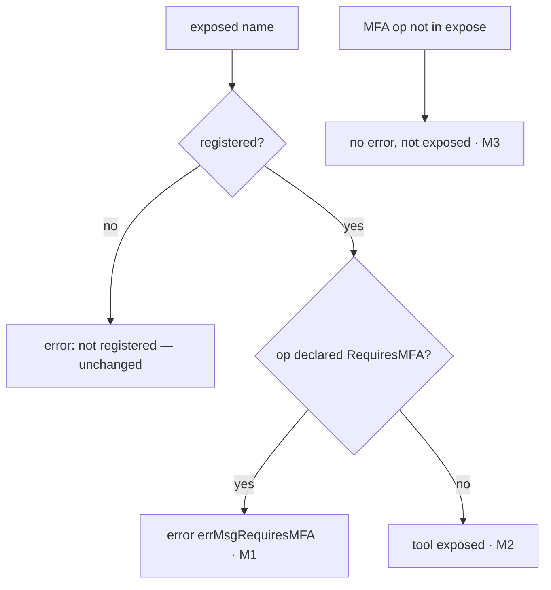

> This plan is dispatched via the CodeJob workflow. See skill: agents-workflow.

# Plan — mcp: multi-factor operations

Read `AGENTS.md` first.

## Why

`webtyp.com/router` (new tag) adds `Route.RequiresMFA()` and
`Context.SetAssurance(model.Assurance)` / `Context.Assurance()`. `mcp`
implements `router.Route` (`opRoute` in `harvest.go`) and `router.Context`
(`opContext` in `harvest.go`), so it must implement both or stop compiling.

An MCP session authenticates with a bearer token: one factor. It **cannot**
prove a second factor, so an operation declared `.RequiresMFA()` must never
become an MCP tool. Closed by default: if the app names such an operation in
`expose`, `HarvestOps` fails loudly instead of silently dropping or serving
it.

## Stage 1 — implement (`harvest.go`)

1. `go get webtyp.com/router@latest webtyp.com/model@latest`. If
   `router.Route` has no `RequiresMFA`, **stop**.
2. `opRegistry`: add an unexported slice `mfa []bool`, index-aligned with
   `tools`. Every place that appends to `tools` appends `false` to `mfa` too.
   `Tool` (public struct) is **not** changed.
3. `opRoute.RequiresMFA()`: `rt.owner.mfa[rt.idx] = true; return rt`.
4. `opContext`: add field `assurance model.Assurance`, `SetAssurance` stores
   it, `Assurance()` returns `model.AssuranceNone` when `userID == ""`.
5. `HarvestOps`, inside the `expose` loop, when the matching tool is found at
   index `i`: if `reg.mfa[i]`, return
   `nil, harvestError("mcp: exposed tool " + string(exp) + errMsgRequiresMFA)`.
   Add to `constants.go`:
   `errMsgRequiresMFA = " requires MFA, which an MCP session (a single bearer token) cannot prove: remove it from expose"`.
   An MFA operation that is **not** in `expose` is fine and harvests silently,
   because it is never served.

## Branch diagram

| Branch | Test (`tests/harvest_mfa_test.go`) |
|---|---|
| M1 | a module whose `MountOperations` registers op `"wipe"` with `.Requires(res, model.Delete).RequiresMFA()`; `HarvestOps([]ToolName{"<module>.wipe"}, m)` returns an error containing `requires MFA` |
| M2 | same module plus op `"list"` without MFA; exposing only `list` succeeds and `Tools()` has exactly one tool |
| M3 | exposing only `list` while `wipe` (MFA) is registered: no error, `wipe` absent from `Tools()` |
| `opContext.Assurance` None-when-anonymous | covered indirectly: no test needed beyond compile, because `opContext` is unexported. Do **not** export it for a test. |

Use the real qualified-name format of the existing `tests/harvest_test.go`
(copy how it builds the module and the expose list).

## Stages

| # | Files | Done when |
|---|---|---|
| 1 | `go.mod`, `go.sum`, `harvest.go`, `constants.go` | compiles against the new router |
| 2 | `tests/harvest_mfa_test.go` | M1–M3 green |
| 3 | `README.md` (HarvestOps section: one sentence: an op that `RequiresMFA` cannot be exposed) | docs match |

## Acceptance criteria

- `gotest` green (stdlib and WASM).
- `grep -n "MFA" tools.go` → empty (the public `Tool` struct is untouched).
- Before opening the PR: `git diff --stat main` lists every file of the
  stages table, and no file is deleted that this plan does not order deleted.
